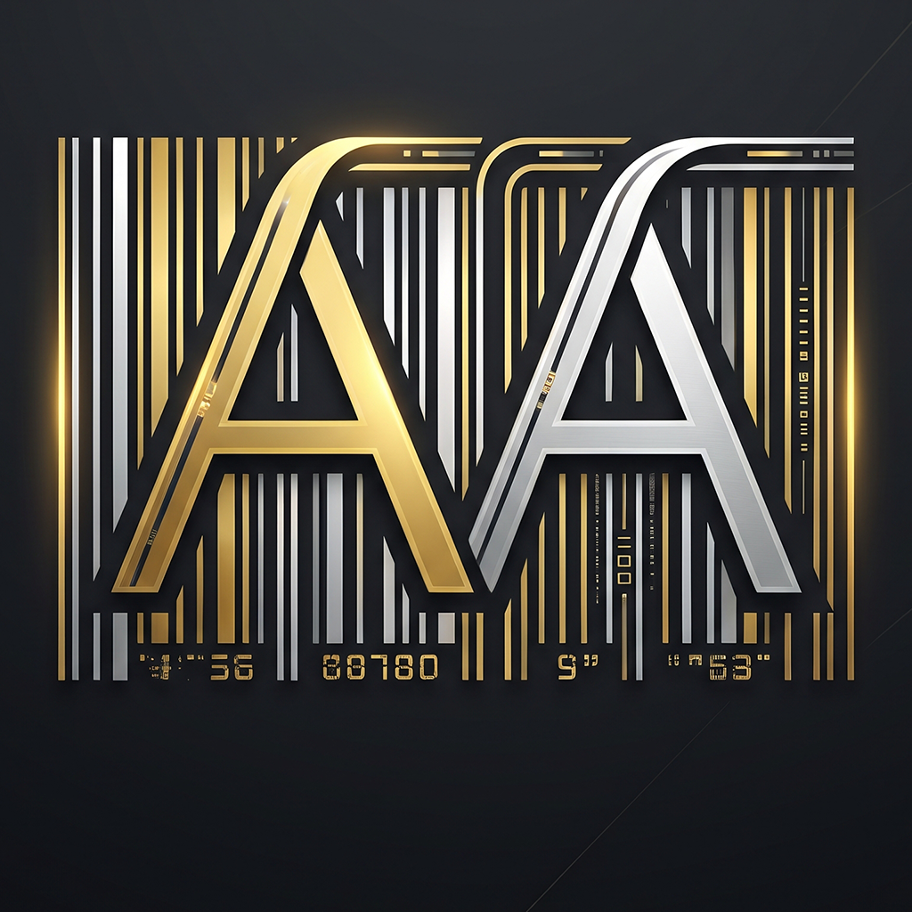

<p align="center">
  
</p>

# my_barcode

Настольная программа для Windows: визуальный редактор стикеров со штрих-кодами и печать на выбранный принтер.

Размер стикера по умолчанию 60×40 мм. Любой элемент можно поставить в нужное место мышью или ввести точные координаты в миллиметрах.

Интерфейс оформлен в стиле Windows 11 (Fluent Design): светлая и тёмная тема следуют за системой, акцентный цвет берётся из настроек Windows.

## Возможности

**Редактор стикера**
- Произвольный размер в мм, быстрые пресеты: 60×40, 58×40, 40×30, 100×50.
- Элементы: текст, штрих-код, линия, рамка, логотип и фоновое фото.
- Перетаскивание мышью, изменение размера за угловую точку, точный ввод X, Y, ширины и высоты.
- Поворот любого элемента на любой угол: за кружок над элементом (с Shift шаг 15°, рядом с ровными углами прилипает), кнопками ±15°, 0°/90°/180°/270° или вводом угла.
- Размер текста меняется прямо на стикере за угловую ручку, кнопками А− и А+, клавишами `+` и `−` или вводом числа.
- Дублирование и удаление элементов, список слоёв и порядок наложения (вперёд, назад, наверх, на задний план).

**Изображения**
- Логотип или фото из файла (PNG, JPG, BMP, GIF, WebP).
- Режим «Фон» растягивает картинку на весь стикер и отправляет её на задний план.
- Прозрачность, режим «заполнить с обрезкой» или «вписать», замена файла без потери положения.
- Картинка сохраняется внутри шаблона, поэтому шаблон можно переносить на другой компьютер одним файлом.

**Штрих-коды**
- Code 128, EAN-13, Code 39 и QR-код.
- Проверка значения: если оно не подходит под тип, программа подсказывает, что допустимо.
- Цифры под кодом можно отключить.

**Печать**
- Выбор любого установленного принтера Windows и количество копий.
- Предпросмотр перед печатью.
- Вывод векторный, поэтому штрих-коды получаются чёткими. Размер страницы равен размеру стикера.

**Шаблоны**
- Сохранение и загрузка макетов.
- Предупреждение о несохранённых изменениях при открытии другого шаблона и при закрытии программы.

## Горячие клавиши

| Клавиши | Действие |
|---|---|
| `Ctrl+S` | Сохранить шаблон |
| `Ctrl+O` | Открыть шаблон |
| `Ctrl+P` | Печать |
| `Ctrl+D` | Дублировать элемент |
| `+` / `−` | Размер текста больше или меньше |
| `R` / `Shift+R` | Повернуть на 15° по или против часовой |
| `Del` | Удалить элемент |
| Стрелки | Сдвинуть элемент на 0,5 мм |
| `Shift` + стрелки | Сдвинуть элемент на 5 мм |

## Запуск

Нужны [Flutter](https://docs.flutter.dev/get-started/install/windows) и Visual Studio с компонентом «Разработка классических приложений на C++».

```bash
git clone https://github.com/Bnutss/my_barcode.git
cd my_barcode
flutter pub get
flutter run -d windows
```

Сборка готового приложения:

```bash
flutter build windows --release
```

Результат лежит в `build/windows/x64/runner/Release/`. Запускайте `my_barcode.exe` из этой папки целиком, рядом с ним нужны DLL и папка `data`.

### Готовая сборка из GitHub Actions

При каждом пуше в `main` GitHub сам собирает Windows-версию, прогоняет анализ и тесты. Готовый архив лежит на вкладке **Actions**: откройте последний запуск и скачайте `my_barcode-windows` из раздела Artifacts. Распакуйте архив целиком и запустите `my_barcode.exe`.

Чтобы выпустить релиз с архивом, создайте тег:

```bash
git tag v1.0.0
git push origin v1.0.0
```

Для проверки интерфейса и логики на macOS или Linux можно добавить нужную платформу (`flutter create --platforms=macos .`) и запустить `flutter run -d macos`. Оконные настройки Windows в этом случае отключены автоматически.

## Где хранятся шаблоны

Шаблоны сохраняются в обычных JSON-файлах:

```
%APPDATA%\my_barcode\templates\<имя>.json
```

Их можно копировать на другой компьютер вручную.

## Настройка принтера

Для термопринтеров (Zebra, TSC, Xprinter, Godex и др.) в настройках драйвера Windows выберите бумагу того же размера, что и стикер, например 60×40 мм. Иначе принтер может масштабировать или сдвигать печать.

Кириллица в печати использует системный шрифт Arial из `C:\Windows\Fonts`.

## Технологии

| Задача | Пакет |
|---|---|
| Интерфейс в стиле Windows 11 | [`fluent_ui`](https://pub.dev/packages/fluent_ui) |
| Заголовок окна, перехват закрытия | [`window_manager`](https://pub.dev/packages/window_manager) |
| Материал Mica | [`flutter_acrylic`](https://pub.dev/packages/flutter_acrylic) |
| Акцентный цвет системы | [`system_theme`](https://pub.dev/packages/system_theme) |
| Выбор файла изображения | [`file_selector`](https://pub.dev/packages/file_selector) |
| Генерация штрих-кодов | [`barcode`](https://pub.dev/packages/barcode), [`barcode_widget`](https://pub.dev/packages/barcode_widget) |
| PDF, список принтеров, печать | [`pdf`](https://pub.dev/packages/pdf), [`printing`](https://pub.dev/packages/printing) |

## Структура проекта

```
lib/
├── main.dart          запуск, настройка окна и темы
├── editor_page.dart   экран редактора: холст, панели, печать
├── models.dart        элементы стикера и их сериализация
├── pdf_builder.dart   сборка PDF стикера для печати
└── templates.dart     сохранение и загрузка шаблонов
```

## Автор

Asad Abdullajonov Programm

## Планы

- Выравнивание текста и несколько строк.
- Печать напрямую командами ZPL и TSPL.
- Импорт и экспорт шаблонов через выбор файла.
